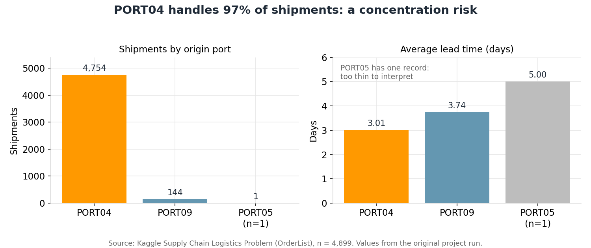
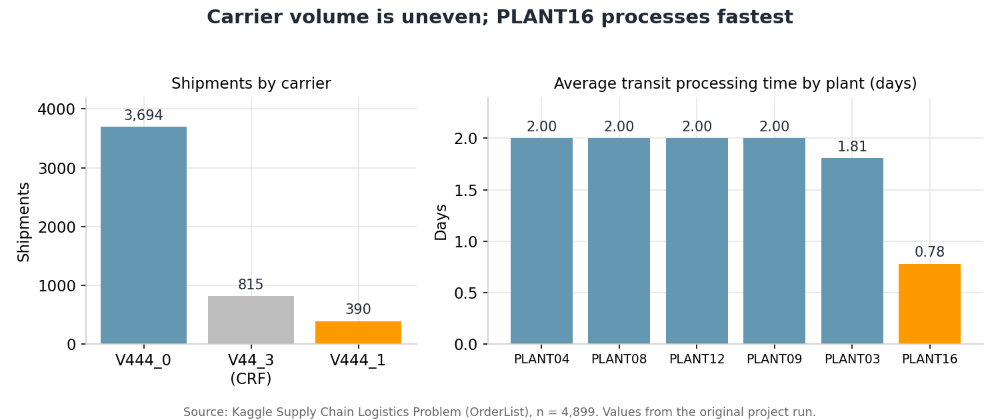
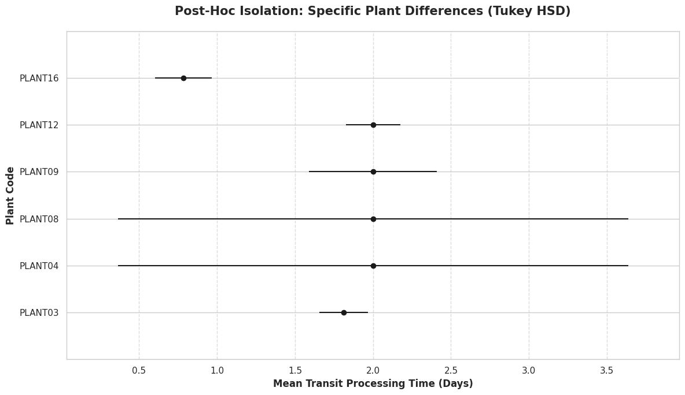
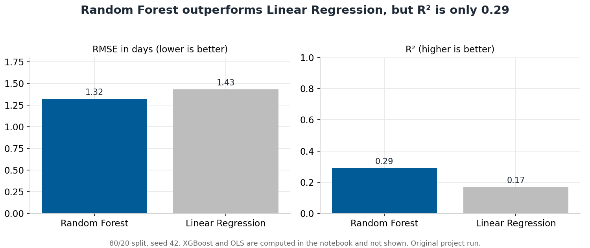

# Supply Chain Logistics Analysis

**Lead-time bottlenecks in a multi-echelon logistics network** | Data Science Bootcamp #15 capstone (April 2026)

An analysis of 4,899 shipment records that asks where a logistics network loses time and which operational decisions deserve a pilot. It combines exploratory analysis, statistical testing (ANOVA, Welch t-test, Tukey HSD, Pearson) and a lead-time prediction model, all in Python.

| Resource | Link |
|---|---|
| Kaggle notebook | [add link] |
| Tableau dashboard | [add link when published] |
| Presentation (PowerPoint) | [reports/Capstone_Portfolio_Presentation.pptx](reports/Capstone_Portfolio_Presentation.pptx) |

## Business problem

Siloed supply chain stages turn small demand swings into overstocking (the bullwhip effect). Unpredictable port and transit times then force extra buffer inventory and tie up capital.

**Objectives**
1. Identify bottlenecks in the network using statistical analysis.
2. Build a machine-learning model to predict total lead time.
3. Deliver actionable, evidence-backed recommendations.

**Business questions**
- Where is shipment volume concentrated, and does it affect lead time?
- Do carrier, port and plant significantly change processing or lead time?
- Which factors predict lead time, and how accurately?
- Which actions should operations test first?

## Dataset

| Item | Detail |
|---|---|
| Source | [Supply Chain Logistics Problem](https://www.kaggle.com/datasets/anisseezzebdi/supply-chain-logistics-problem) on Kaggle (owner `anisseezzebdi`) |
| Table used | `OrderList` (9,215 rows x 14 columns); the other tables were not analysed |
| Records analysed | 4,899 after cleaning |
| Identifiers | Anonymised port, plant and carrier codes. The project report states the data contains no personal information |
| Licence | See the dataset page on Kaggle; raw data is **not** redistributed in this repository |

The `Order Date` column holds a single date, so the analysis is **cross-sectional** (no trend or seasonality). The Malaysian logistics context is the project framing; locations in the data are codes.

## Methodology

1. **Load and inspect** the `OrderList` table.
2. **Clean:** median-fill `Weight`, remove duplicates, derive `Total_Lead_Time = TPT + Ship ahead day count`, cap at 5,000 records (project size guideline), trim `Weight` outside the 1st to 99th percentile (-> 4,899 records).
3. **Derive** `Delivery_Delay = Total_Lead_Time - TPT`.
4. **Explore:** KPIs for volume, lead time, TPT, delay and weight; correlation, distribution and carrier/plant profiles.
5. **Test:** one-way ANOVA (carrier vs TPT; port vs lead time), one-sided Welch t-test (highest-delay plant vs rest), Pearson (weight vs lead time), Tukey HSD (plants).
6. **Model:** Linear Regression, OLS, Random Forest, XGBoost and tuned XGBoost (5-fold GridSearchCV); 80/20 split, seed 42; compared on RMSE, MAE and R2.

**Tools:** Python, pandas, NumPy, SciPy, statsmodels, scikit-learn, XGBoost, Matplotlib, Seaborn, Plotly; Tableau (dashboard); Kaggle Notebooks.

## Key findings

Figures below come from the original project run. The notebook recomputes them; compare after running (see *How to reproduce*).

| Area | Finding |
|---|---|
| Port concentration | PORT04 handled 4,754 of 4,899 shipments (97%); PORT09 144; PORT05 1 (too thin to interpret) |
| Port lead time | Average 3.01 days (PORT04) vs 3.74 days (PORT09); port effect is significant (ANOVA F = 16.08, p = 1.09e-07) |
| Carrier | Carrier affects TPT (ANOVA F = 754.0, p = 3.46e-286). In OLS, V444_1 is linked to about 0.44 fewer lead-time days than V444_0, but it carries only 390 shipments (8%) vs 3,694 (75%) |
| Plant | Average TPT 2.00 days at PLANT04, 08, 09 and 12, 1.81 at PLANT03, 0.78 at PLANT16. Tukey HSD: PLANT16 is significantly faster than PLANT03, 09 and 12. PLANT09 delay is above the network (t = 8.04, p = 3.0e-06) |
| Weight and TPT | Weight vs lead time: r = 0.067 (weak). TPT vs lead time: r = 0.32 (moderate) |
| Prediction | Random Forest: RMSE 1.32 days, MAE 1.08, R2 0.29. Linear Regression: RMSE 1.43, R2 0.17 |

XGBoost and OLS results are computed in the notebook. Figures quoted in earlier project documents did not match saved outputs, so they are not repeated here.

## Recommendations

Each is a pilot to validate, not a proven saving. No cost analysis was performed.

1. **Reduce single-port dependence.** Pilot routing selected non-urgent shipments through a secondary port and track lead time. The aim is resilience, not speed (PORT09 currently averages longer).
2. **Test carrier consolidation.** Pilot more volume with V444_1 before committing, then add TPT and on-time SLA terms. Exclude the customer-arranged carrier V44_3.
3. **Review plant workload and buffers.** Rebalance toward faster plants and size safety stock on lead time; validate with capacity and cost data.

## Visualisations


*PORT04 carried 4,754 of 4,899 shipments (97%). PORT05 has a single record, so its 5.00-day average is not interpretable.*


*V444_1 handles 390 shipments (8%) against 3,694 (75%) for V444_0. PLANT16 averages 0.78 days of transit processing, against 2.00 at four other plants.*


*Tukey HSD intervals for mean TPT by plant: PLANT16 sits clearly below PLANT03, 09 and 12. The very wide PLANT04 and PLANT08 intervals suggest few records.*


*On the shared 80/20 test set, Random Forest scores RMSE 1.32 days and R2 0.29; Linear Regression scores 1.43 and 0.17.*

> **Chart sources:** charts 1, 2 and 4 are redrawn from the summary values of the original project run (the same numbers as the tables in this README). Chart 3 is exported from the original notebook with its text annotation removed. After a verified run of the refined notebook, replace all four with its exports using the same file names. A Tableau dashboard screenshot can be added once published.

<!--  -->

## Repository structure

```
supply-chain-logistics-analysis/
├── README.md
├── requirements.txt
├── .gitignore
├── notebooks/
│   └── supply_chain_logistics_analysis.ipynb
├── data/
│   └── README.md          # how to obtain the dataset (raw data not committed)
├── images/                # charts used in this README (4 PNG files)
└── reports/
    └── Capstone_Portfolio_Presentation.pptx
```

## How to reproduce

1. `pip install -r requirements.txt` (Python version tested: [add after a verified run]).
2. Get the dataset (see `data/README.md`). Either set `ORDERS_PATH` to the Excel file, or install `kagglehub` and let the notebook download it. If credentials are requested, follow the kagglehub documentation and never commit them.
3. Run `notebooks/supply_chain_logistics_analysis.ipynb` top to bottom. Set `FAST_MODE = True` for a quick test (smaller XGBoost grid).
4. The notebook prints a note if the record count differs from 4,899. All order dates are identical, so the sort that picks the 5,000 rows can vary between library versions and shift results slightly.

## Limitations

- Single order date: no trend, seasonality or time-based validation.
- Small groups (PORT05 has one record; some plants have few), so those results are indicative only.
- R2 is modest (0.29); congestion, weather and other external factors are not in the data.
- Only `OrderList` was used; no freight-cost or capacity analysis, so no savings are claimed.

## Team and credits

Team project, Data Science Bootcamp #15. **Hazaimi Hamdani** (data cleaning, statistical analysis) and **Intan Nurhazwani** (EDA, modelling, reporting), as credited in the project notebook. GitHub profiles: [add].

Dataset credit: *Supply Chain Logistics Problem* on Kaggle (owner `anisseezzebdi`).

## Licence

[Add a licence for the code, for example MIT. The dataset keeps its own licence.]
